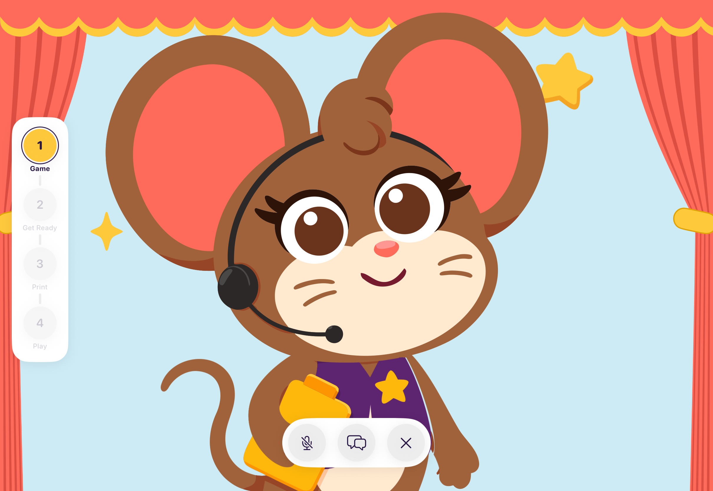
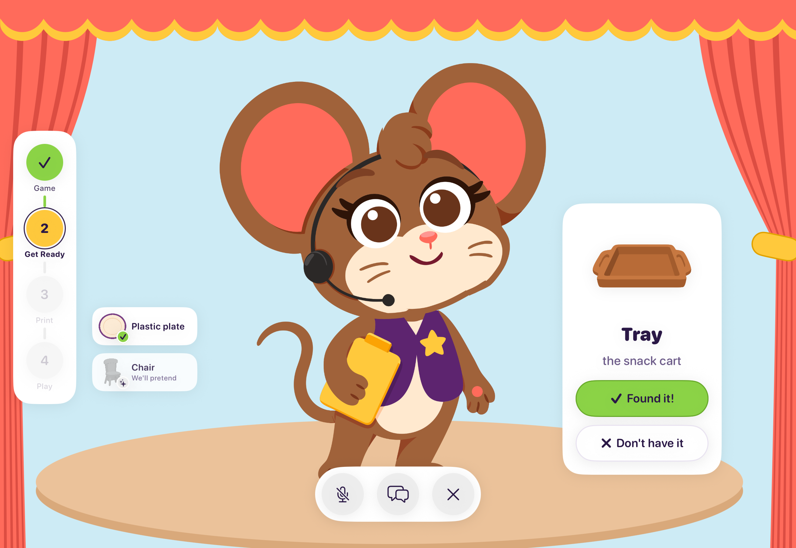
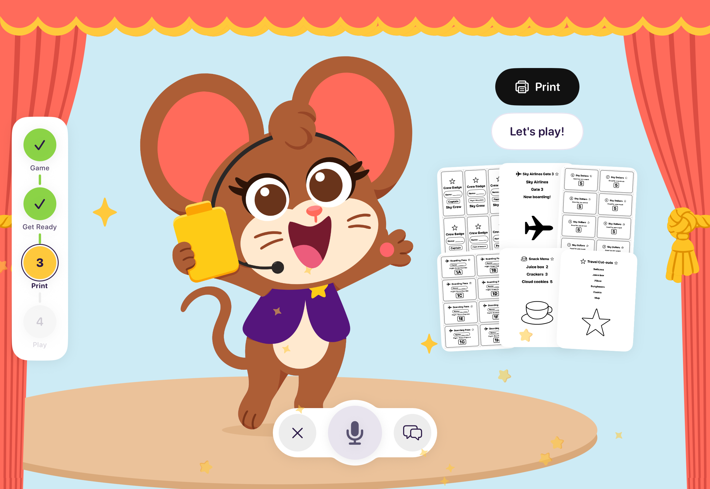
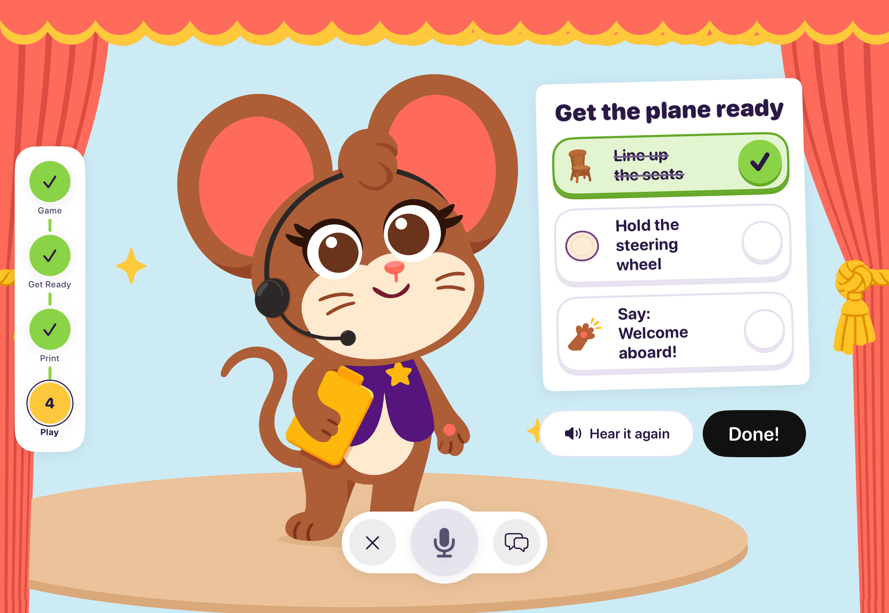

# PretendThat

**Turn your living room into a pretend-play adventure.** Meet Nutmeg, your pretend-play stage manager.

PretendThat is an iPad app for kids ages 4 to 8. Nutmeg, a voice-first stage-manager mouse (she/her), takes kids from "I'm bored" to a real pretend-play show in four steps, then steps back so the play happens off the screen.

Built by Haylee McArthur for Southern Utah Code Camp 2026. Demo site: https://pretendthat.app



## How it works

1. **Pick:** kids pick a game and a theme just by talking ("a pancake restaurant on the moon") and say how many kids are playing.
2. **Props:** Nutmeg sends them on a prop hunt for things around the house, one prop at a time, with swaps and skips.
3. **Print:** an AI-generated printable kit (role badges, a sign, play money, tickets, a menu and cutouts) to color and cut, printed with one tap through AirPrint.
4. **Play:** Nutmeg guides the show scene by scene, then steps back and naps while the kids play.

| | |
|---|---|
|  |  |
|  | |

## Privacy

- No accounts, no sign-in, no backend storage.
- Nutmeg never asks for kids' names. Kids are addressed by role (the chef, the captain), not by name.
- Nothing about kids is stored. The whole adventure lives in memory and nothing is written to disk. Every adventure starts fresh.
- No API keys in the app. AI calls go through a stateless relay (a Cloudflare Worker in [`relay/`](relay/README.md)) that holds the keys, checks an app token, rate-limits per IP and forwards the request. It logs and stores nothing. The voice conversation connects to OpenAI with a short-lived secret the relay mints for each session. Developers can use their own keys instead (git-ignored `Secrets.xcconfig`).

## Features

- **Push-to-talk voice:** hold the mic, talk to Nutmeg, and she answers in real time with her own voice.
- **Tool-calling conversation:** the realtime model drives the flow through tool calls (set the game, set the player count, show the next prop), so the steps stay on track while she riffs.
- **Open suggestions, not menus:** "You can pick anything! Maybe a hotel, a pirate ship, or a pet groomer?", with big tap choices as a backup.
- **Prop hunt:** one prop card at a time with picture art, plus swap and skip.
- **AI kit with real per-page progress:** Claude writes the kit and scenes. OpenAI image generation draws each coloring page, and the progress shows real per-page status while Nutmeg "writes" on her clipboard.
- **Checklist with read-aloud:** picture checklists during play, and a "say it again" pill that reads the checklist or her last line aloud.
- **Sleepy Nutmeg:** after a stretch of quiet she sits, gets drowsy and falls asleep (unit-tested doze clock).
- **Survives iPad lock:** locking or backgrounding the iPad pauses the audio but keeps the game. Kit generation keeps running in a background task.
- **Layered vector character animation:** Nutmeg is built from separate vector layers (head, body, arms, clipboard) with breathing, blinking, expressions and poses.
- **Stage camera:** the frame zooms toward Nutmeg while she talks or listens, then zooms out to show ideas, roles and props around her on a backstage-theater stage.
- **Offline fallback:** with no keys, the app runs a bundled sample adventure.

## Tech and architecture

- **Swift 6 and SwiftUI**, iPadOS 17+, strict concurrency.
- **NutmegCore** (Swift package): the app's logic (adventure store, conversation rules, prompts and schemas, API clients, sanitizing and validation, doze clock, kit progress). Covered by **199 unit tests** in 17 suites (Swift Testing).
- **PretendThat** (app target): SwiftUI screens, the Nutmeg character, the voice layer and printing.
- **XcodeGen** generates the Xcode project from `project.yml`.

### Libraries and services

No third-party Swift packages. Everything else is Apple frameworks or a web API.

| Used for | Library or service |
|---|---|
| Live voice conversation and tool calls | OpenAI Realtime API (`gpt-realtime-2.1`, over WebSocket) |
| Transcribing kid speech in the realtime session | OpenAI `gpt-4o-mini-transcribe` |
| Coloring-page and kit art | OpenAI Image API (`/v1/images/generations`, `gpt-image-2` family) |
| Game ideas, game plan, props, kit and scenes, help turns | Anthropic Claude Messages API (`claude-opus-5-5`, structured output) |
| UI | SwiftUI, UIKit |
| Audio capture and playback, fallback voice | AVFoundation (incl. `AVSpeechSynthesizer`) |
| On-device speech recognition fallback | Speech (`SFSpeechRecognizer`) |
| Printing | UIKit printing (`UIPrintInteractionController`, AirPrint) |
| Image processing and animation | Core Image, Core Graphics, QuartzCore |
| State | Observation |
| Project generation | XcodeGen |
| Stateless key relay | Cloudflare Workers (Rate Limiting binding), Wrangler, TypeScript, Vitest (`relay/`) |
| Art creation | ChatGPT image generation, Figma (vectorize and clean up) |
| Development help | Claude Code |

## Repo layout

| Folder | What's in it |
|---|---|
| `PretendThat/` | The iPad app: `App`, `Screens`, `Nutmeg` (character), `Voice`, `Print`, `DesignSystem`, `Theme`, `Resources` |
| `NutmegCore/` | Swift package with the logic and the unit tests |
| `design/` | Art, brand and pitch screens |
| `tools/` | Build, screenshot and art-import scripts |
| `docs/` | Design spec and build plan |
| `relay/` | The stateless key relay (Cloudflare Worker), its tests and deploy steps |
| `thinking/` | Decision log, ideas and open questions ([index](thinking/INDEX.md)) |

## Build and run

Requires Xcode 16+ (Swift 6) and [XcodeGen](https://github.com/yonaskolb/XcodeGen).

A fresh clone just works: no keys and no `Secrets.xcconfig` needed. The committed `Relay.xcconfig` points the app at the shared relay, which supplies Claude, the images and Nutmeg's realtime voice. (If `RELAY_HOST` there is still the `<subdomain>` placeholder, the relay isn't deployed yet and the app runs the bundled fallback adventure.)

1. Optional, dev mode with your own keys:
   ```sh
   cp Secrets.example.xcconfig Secrets.xcconfig
   ```
   Paste `ANTHROPIC_API_KEY` and/or `OPENAI_API_KEY`. Personal keys win over the relay. The file is git-ignored.
2. Generate the project:
   ```sh
   xcodegen
   ```
3. Build for a booted iPad simulator:
   ```sh
   tools/build-sim.sh
   ```
   Or open `PretendThat.xcodeproj` in Xcode and run the `PretendThat` scheme on an iPad or iPad simulator. Voice works best on a real iPad.

### Signing, device builds and App Store archives

- **Bundle ID:** `co.crimsonfoundry.pretendthat` (UI tests: `co.crimsonfoundry.pretendthat.uitests`). The subscription
  product IDs stay `app.pretendthat.showpass.monthly` and so on.
- **Team:** `project.yml` sets `DEVELOPMENT_TEAM = 66898X3HH3` (Crimson Foundry LLC) for every configuration, with
  automatic signing. Simulator builds don't need the team's account in Xcode.
- **Version:** `MARKETING_VERSION` / `CURRENT_PROJECT_VERSION` in `project.yml` (1.0 (1) for the first TestFlight
  upload). Raise `CURRENT_PROJECT_VERSION` for every upload.
- **Archive for TestFlight** (needs an Apple ID on the company team in Xcode → Settings → Accounts):
  ```sh
  xcodegen
  xcodebuild -project PretendThat.xcodeproj -scheme PretendThat -configuration Release \
    -destination 'generic/platform=iOS' -archivePath build/PretendThat.xcarchive -allowProvisioningUpdates archive
  ```
  Then Xcode → Window → Organizer → the archive → Distribute App → App Store Connect.
- **Device build with the free personal team** (TSM76TQF46): the company owns the bundle ID, so the personal team
  needs its own ID. Pass both on the command line (project files stay unchanged):
  ```sh
  xcodebuild -project PretendThat.xcodeproj -scheme PretendThat -configuration Debug \
    -destination 'generic/platform=iOS' -derivedDataPath build/DeviceData -allowProvisioningUpdates \
    DEVELOPMENT_TEAM=TSM76TQF46 PRODUCT_BUNDLE_IDENTIFIER=co.crimsonfoundry.pretendthat.dev build
  ```
  (In Xcode: pick the personal team and change the bundle ID in Signing & Capabilities; `xcodegen` resets both.)
  StoreKit purchases and relay show counts only work with the real bundle ID.
  This build has no iCloud entitlement (project.yml picks the entitlements by team), so saved games stay on the device.
- **iCloud sync (round D4):** CloudKit container `iCloud.co.crimsonfoundry.pretendthat` (company team only). Before a
  TestFlight upload, deploy the CloudKit schema to Production (thinking/decisions/2026-11-17-icloud-sync-before-launch.md).

### Tests

```sh
cd NutmegCore && swift test        # app logic
cd relay && npm install && npm test  # relay Worker (fetch mocked, no keys)
```

## Docs

- [Design spec](docs/superpowers/specs/2026-11-13-pretendthat-design.md)
- [Build plan](docs/superpowers/plans/2026-11-13-pretendthat-plan.md)
- [Thinking index](thinking/INDEX.md): every decision, with the date, the reason and who decided

## Credits

- Built by Haylee McArthur.
- Nutmeg and the app art were made with ChatGPT image generation, then vectorized and cleaned up in Figma.
- Built with help from Claude Code, which ran the build, research and file work in background agents while Haylee made the calls. The decision log in `thinking/` records who decided each one.
